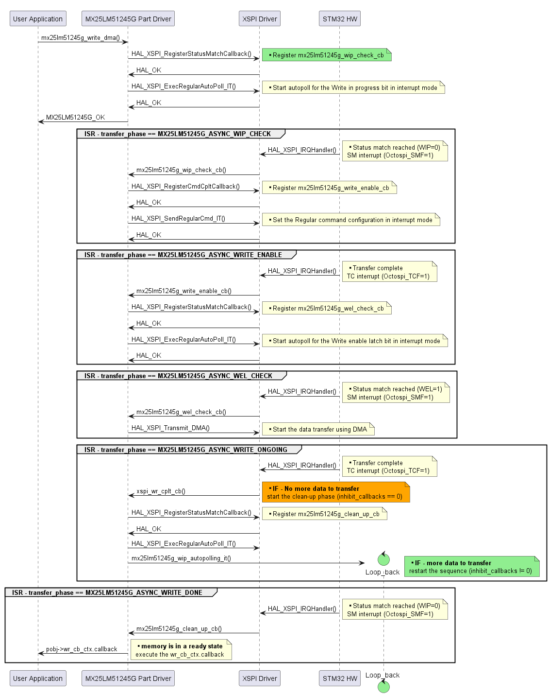

# __MX25LM51245G Part Drivers__


[](https://htmlpreview.github.io/?https://github.com/STMicroelectronics/stm32-mx25lm51245g-part-drivers/blob/main/Release_Notes.html)

## Overview

The MX25LM51245G part drivers provides APIs to drive the MX25LM51245G octospi memory through XSPI HAL drivers.

## Description

### Part MX25LM51245G, the octospi memory features are controlled through XSPI HAL API.

### Peripherals initialization:
   Part MX25LM51245G assumes that the initialisation of all needed peripherals (XSPI, DMA, GPIO) is done by the main application. The GPIO peripheral is usually initialized by the auto generated code produced by the STM32CubeMX2 tool, otherwise it up to the user to correctly initializes the GPIO peripheral.


## How to use it?

To use the MX25LM51245G part driver APIs, the application must define the mx25lm51245g object and assign XSPI HW resources to it.

mx25lm51245g object struct:
```
typedef struct mx25lm51245g_obj_s mx25lm51245g_obj_t;

struct mx25lm51245g_obj_s
{
  mx25lm51245g_init_state_t       is_initialized;    /*!< Init state                              */
  mx25lm51245g_access_t           access_mode;       /*!< Access mode: indirect, MMP or none      */
  mx25lm51245g_io_t               pio;               /*!< IO interface structure                  */
  mx25lm51245g_interface_t        interface;         /*!< Interface: OSP or OPI                   */
  mx25lm51245g_transfer_rate_t    transfer_rate;     /*!< Transfer rate: STR or DTR               */
#if defined (MX25LM_CALLBACKS) && (MX25LM_CALLBACKS == 1)
  volatile uint32_t               inhibit_callbacks; /*!< Used for multi-pages writes             */
  mx25lm51245g_callback_ctx_t     rd_cb_ctx;         /*!< Read  Complete: Callback data           */
  mx25lm51245g_callback_ctx_t     wr_cb_ctx;         /*!< Write Complete: Callback data           */
  mx25lm51245g_callback_ctx_t     ce_cb_ctx;         /*!< Chip Erase Complete: Callback data      */
  mx25lm51245g_callback_ctx_t     be_cb_ctx;         /*!< Block Erase Complete: Callback data     */
  uint32_t                        transfer_addr;     /*!< Data transfer address    - async writes */
  uint32_t                        last_page_size;    /*!< Last page size           - async writes */
  uint32_t                        nb_transfer;       /*!< Number of pages to write - async writes */
  mx25lm51245g_addr_size_t        addr_size;         /*!< Addressing mode 3/4bytes - async writes */
  mx25lm51245g_transfer_phase_t   transfer_phase;    /*!< Memory Transfer step     - async writes */
  const uint8_t                   *transfer_buffer;  /*!< Write data buffer        - async writes */
#endif /* MX25LM_CALLBACKS */
};
```
The application must implement the following:

```
#define MX_MX25LM51245G_0       0 /* instance id */

```
A redefinition of the `mx25lm51245g_io_init()` function where the XSPI handle getter function is linked to the mx25lm51245g object:

```
int32_t mx25lm51245g_io_init(mx25lm51245g_io_t *pio)
{
   switch (pio->id)
  {
    case MX_MX25LM51245G_0:
      pio->hxspi = MX_MX25LM51245G_0_XSPI_GETHANDLE();
      break;
    default:
      return -1;
  }
  return 0;
}
```
The link to the xspi handle getter function is done in the `mx25lm51245g_io_init()`, which is internally called by the `mx25lm51245g_init()` API.
The `mx25lm51245g_init()` function must be the first API to be called. Once this is successfully done, all operations can be called.
```
mx25lm51245g_obj_t FlashObj;

(...)

mx25lm51245g_init(&FlashObj, MX_MX25LM51245G_0);
```

## __Asynchronous write__

The MX25LM51245G part driver provides full asynchronous write functionality, including multipage writes management through the use of an internal asynchronous state machine.

To use this feature, both `USE_HAL_XSPI_REGISTER_CALLBACKS` and `USE_HAL_XSPI_USER_DATA` must be enabled, and the write complete callback must be registered with the `mx25lm51245g_register_write_cplt_callback()` API.

The state machine starts with the call to `mx25lm51245g_write_dma()` and stops when all data has been transmitted. At that point, the previously registered callback function will be called.

The transfer phase can also be followed with the `mx25lm51245g_get_async_write_phase()` function.

```
typedef enum
{
  MX25LM51245G_ASYNC_WRITE_IDLE = 0,        /*!< Idle state - no ongoing transfer              */
  MX25LM51245G_ASYNC_WIP_CHECK,             /*!< Autopoll WIP bit        - Async write step 1  */
  MX25LM51245G_ASYNC_WRITE_ENABLE,          /*!< Send write enable cmd   - Async write step 2  */
  MX25LM51245G_ASYNC_WEL_CHECK,             /*!< Autopoll WEL bit        - Async write step 3  */
  MX25LM51245G_ASYNC_WRITE_ONGOING,         /*!< Data transmission phase - Async write step 4  */
  MX25LM51245G_ASYNC_WRITE_DONE             /*!< Clean-up step WIP check - Async write step 5  */
} mx25lm51245g_transfer_phase_t;
```

The diagram below demonstrates an async write sequence:
<!--
@startuml{doc/mx25lm51245g_async_write_diagram.png}
"User Application"->"MX25LM51245G Part Driver" : mx25lm51245g_write_dma()
"MX25LM51245G Part Driver"->"XSPI Driver" : HAL_XSPI_RegisterStatusMatchCallback()
note right #LightGreen: ** Register mx25lm51245g_wip_check_cb
"XSPI Driver"-> "MX25LM51245G Part Driver" : HAL_OK
"MX25LM51245G Part Driver"->"XSPI Driver" : HAL_XSPI_ExecRegularAutoPoll_IT()
note right: ** Start autopoll for the Write in progress bit in interrupt mode
"XSPI Driver"-> "MX25LM51245G Part Driver" : HAL_OK
"MX25LM51245G Part Driver"->"User Application": MX25LM51245G_OK

group ISR - transfer_phase == MX25LM51245G_ASYNC_WIP_CHECK
"XSPI Driver" <- "STM32 HW" : HAL_XSPI_IRQHandler()
note right: ** Status match reached (WIP=0) \n SM interrupt (Octospi_SMF=1)
"XSPI Driver"-> "MX25LM51245G Part Driver" : mx25lm51245g_wip_check_cb()
"MX25LM51245G Part Driver"->"XSPI Driver" : HAL_XSPI_RegisterCmdCpltCallback()
note right: ** Register mx25lm51245g_write_enable_cb
"XSPI Driver"-> "MX25LM51245G Part Driver" : HAL_OK
"MX25LM51245G Part Driver"->"XSPI Driver" : HAL_XSPI_SendRegularCmd_IT()
note right: ** Set the Regular command configuration in interrupt mode
"XSPI Driver"-> "MX25LM51245G Part Driver" : HAL_OK
end

group ISR - transfer_phase == MX25LM51245G_ASYNC_WRITE_ENABLE
"XSPI Driver" <- "STM32 HW" : HAL_XSPI_IRQHandler()
note right: ** Transfer complete \n TC interrupt (Octospi_TCF=1)
"XSPI Driver"-> "MX25LM51245G Part Driver" : mx25lm51245g_write_enable_cb()
"MX25LM51245G Part Driver"->"XSPI Driver" : HAL_XSPI_RegisterStatusMatchCallback()
note right: ** Register mx25lm51245g_wel_check_cb
"XSPI Driver"-> "MX25LM51245G Part Driver" : HAL_OK
"MX25LM51245G Part Driver"->"XSPI Driver" : HAL_XSPI_ExecRegularAutoPoll_IT()
note right: ** Start autopoll for the Write enable latch bit in interrupt mode
"XSPI Driver"-> "MX25LM51245G Part Driver" : HAL_OK
end

group ISR - transfer_phase == MX25LM51245G_ASYNC_WEL_CHECK
"XSPI Driver" <- "STM32 HW" : HAL_XSPI_IRQHandler()
note right: ** Status match reached (WEL=1) \n SM interrupt (Octospi_SMF=1)
"XSPI Driver"-> "MX25LM51245G Part Driver" : mx25lm51245g_wel_check_cb()
"MX25LM51245G Part Driver"->"XSPI Driver" : HAL_XSPI_Transmit_DMA()
note right: ** Start the data transfer using DMA
end

group ISR - transfer_phase == MX25LM51245G_ASYNC_WRITE_ONGOING
"XSPI Driver" <- "STM32 HW" : HAL_XSPI_IRQHandler()
note right: ** Transfer complete \n TC interrupt (Octospi_TCF=1)
"XSPI Driver"-> "MX25LM51245G Part Driver" : xspi_wr_cplt_cb()
note right #Orange: ** <B>IF - No more data to transfer \n start the clean-up phase (inhibit_callbacks == 0)
"MX25LM51245G Part Driver"->"XSPI Driver" : HAL_XSPI_RegisterStatusMatchCallback()
note right : ** Register mx25lm51245g_clean_up_cb
"XSPI Driver"-> "MX25LM51245G Part Driver" : HAL_OK
"MX25LM51245G Part Driver"->"XSPI Driver" : HAL_XSPI_ExecRegularAutoPoll_IT()
create control Loop_back #LightGreen
"MX25LM51245G Part Driver"->"Loop_back": mx25lm51245g_wip_autopolling_it()
note right #LightGreen: ** <B>IF - more data to transfer \n restart the sequence (inhibit_callbacks != 0)
end

group ISR - transfer_phase == MX25LM51245G_ASYNC_WRITE_DONE
"XSPI Driver" <- "STM32 HW" : HAL_XSPI_IRQHandler()
note right: ** Status match reached (WIP=0) \n SM interrupt (Octospi_SMF=1)
"XSPI Driver"-> "MX25LM51245G Part Driver" : mx25lm51245g_clean_up_cb()
"MX25LM51245G Part Driver"->"User Application": pobj->wr_cb_ctx.callback
note right : ** <B>memory is in a ready state \n execute the wr_cb_ctx.callback
end

@enduml
-->



## __Tests__

Unitary test has been performed for each feature.